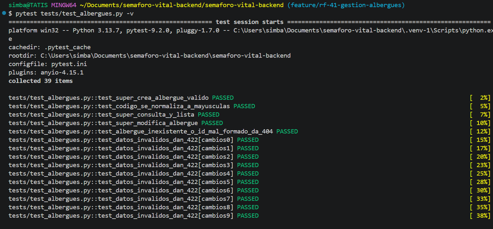
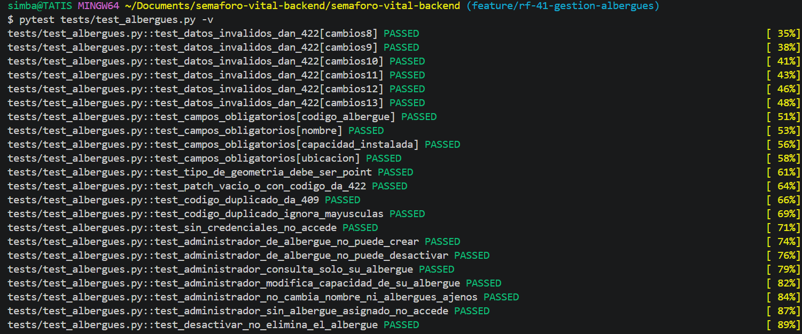
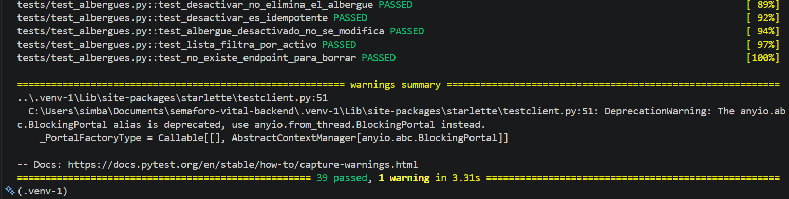
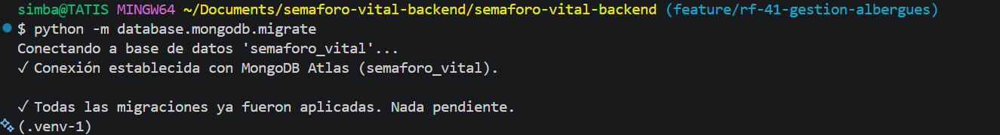
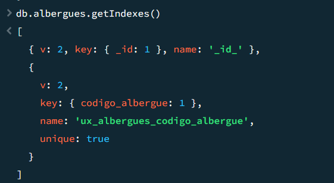

# Evidencias: gestión de albergues (RF-41, RF-43, RF-14, RF-15, RNF-05, RNF-12)

**Proyecto:** Semáforo Vital
**Historia de usuario:** Como súper administrador, quiero registrar, consultar, modificar y desactivar albergues.
**Fecha de validación:** _(14/11/2026)_
**Responsable:** _(Tatiana miranda)_

---

## 1. Trazabilidad de criterios de aceptación

| Criterio | Implementación | Pruebas |
|---|---|---|
| Crear albergues con código, nombre, ubicación y capacidad | `POST /api/v1/albergues` (`app/api/v1/endpoints/albergues.py`) | `test_super_crea_albergue_valido` |
| Código no repetible | Índice único `ux_albergues_codigo_albergue` (migración `003_harden_data_integrity`) + 409 | `test_codigo_duplicado_da_409`, `test_codigo_duplicado_ignora_mayusculas` |
| Validación de obligatorios y coordenadas | Modelos Pydantic en `app/domain/albergues.py` + `$jsonSchema` | `test_datos_invalidos_dan_422`, `test_campos_obligatorios`, `test_tipo_de_geometria_debe_ser_point` |
| Consultar y modificar | `GET /albergues`, `GET /albergues/{id}`, `PATCH /albergues/{id}` | `test_super_consulta_y_lista`, `test_super_modifica_albergue` |
| Desactivar sin borrar historial | `PATCH /albergues/{id}/desactivar` (borrado lógico, sin `DELETE`) | `test_desactivar_no_elimina_el_albergue`, `test_no_existe_endpoint_para_borrar` |
| Solo usuarios autorizados | `require_role` + reglas en `AlbergueService` | `test_administrador_de_albergue_no_puede_crear`, `..._desactivar`, `test_sin_credenciales_no_accede` |
| Pruebas válidos / inválidos / duplicados / permisos | `tests/test_albergues.py` | Ver sección 2 |

---

## 2. Evidencia: pruebas de endpoints

Comando:

```bash
python -m pytest tests/test_albergues.py -v
```

Resultado: 




---

## 3. Evidencia: persistencia en MongoDB

### 3.1 Migración aplicada

```bash
python -m database.mongodb.migrate
```



### 3.2 Índice único

```javascript
db.albergues.getIndexes()
```


### 3.3 Flujo contra la API real

Con token de súper administrador:

| Paso | Petición | Esperado | Captura |
|---|---|---|---|
| 1 | `POST /api/v1/albergues` | 201 | |
| 3 | `PATCH /api/v1/albergues/{id}` | 200 | |
| 4 | `PATCH /api/v1/albergues/{id}/desactivar` | 200, `activo: false` | _(pegar)_ |
| 5 | `GET /api/v1/albergues/{id}` | 200, sigue existiendo | _(pegar)_ |
| 6 | `POST` con token de `administrador_albergue` | 403 | _(pegar)_ |

### 3.4 Documento persistido

```javascript
db.albergues.find({ codigo_albergue: "<CODIGO_USADO>" })
```

_(captura: campos `activo: false`, `fecha`, `updated_by`, `registrado_por`)_

---

## 4. Evidencia: revisión de código

- Pull request: _(enlace)_
- Revisor: _(nombre)_
- Archivos revisados:
  - `app/domain/albergues.py`
  - `app/application/albergues.py`
  - `app/api/v1/endpoints/albergues.py`
  - `app/infrastructure/repositories/mongo_albergue_repository.py`
  - `database/mongodb/docs/nota_ajuste_validador_albergues.md`
  - `tests/test_albergues.py`
